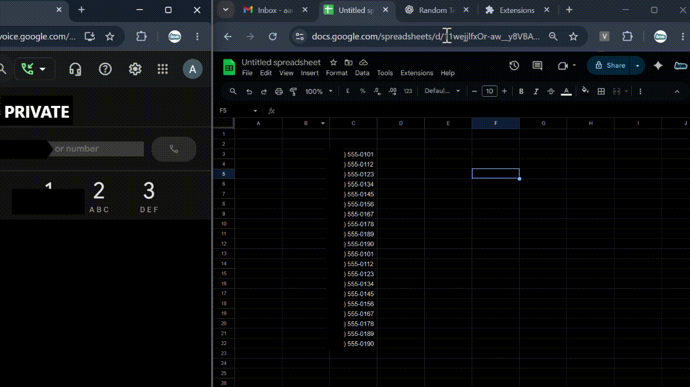

<div align="center">

  

  # 1TapDial

  ### One-click calling from Google Sheets with Google Voice

  <p>
    A lightweight, open-source Chrome extension that detects phone numbers in Google Sheets,
    sends them to Google Voice, and starts the call automatically.
  </p>

  <p>
    
    
    
  </p>

  <p>
    <a href="#features">Features</a> ·
    <a href="#installation">Installation</a> ·
    <a href="#usage">Usage</a> ·
    <a href="#development">Development</a> ·
    <a href="#contributing">Contributing</a>
  </p>

</div>

<br>



## Overview

Sheets to Voice streamlines calling workflows for teams that keep contact lists in Google Sheets. Select a cell containing a phone number and the extension will:

1. Detect and normalize the number.
2. Find an open Google Voice tab.
3. Place the number in the Google Voice dialer.
4. Click the available **Call** button.

The extension runs entirely in your browser. There is no server, account database, analytics service, or external API key.

> **Important:** Google Voice must be open and signed in before dialing. The extension automates the Google Voice web interface; it does not provide phone service or bypass Google Voice requirements.

## Features

- **Single-click dialing** — select a phone-number cell in Google Sheets to begin.
- **Flexible number detection** — supports plain and commonly formatted numbers, including `+1 (555) 123-4567`.
- **Google Voice handoff** — sends the detected number to an existing Google Voice tab.
- **Automatic call action** — clicks the Google Voice call control after the number is inserted.
- **Connection recovery** — reconnect content scripts from the popup when a tab needs to be refreshed.
- **Resilient page handling** — retries while Sheets or Voice finishes rendering dynamic UI elements.
- **Lightweight and local** — vanilla JavaScript, no build step, no backend, and no runtime dependencies.

## Requirements

- Google Chrome or another Chromium-based browser with Manifest V3 support.
- An active Google account with access to:
  - [Google Sheets](https://docs.google.com/spreadsheets/)
  - [Google Voice](https://voice.google.com/)
- A Google Sheet containing phone numbers with 10–15 digits, optionally prefixed with `+`.

## Installation

### Option 1: Load the extension locally

1. Clone the repository:

   ```bash
   git clone https://github.com/abmdevx/1tapdial.git
   cd 1tapdial
   ```

2. Open `chrome://extensions` in Chrome.
3. Enable **Developer mode** in the top-right corner.
4. Select **Load unpacked**.
5. Choose the cloned `1tapdial` directory.
6. Pin **Sheets to Voice** from the Extensions menu for quick access.

### Option 2: Download the source

1. Open the repository on GitHub.
2. Select **Code → Download ZIP**.
3. Extract the archive.
4. Follow steps 2–5 above and select the extracted directory.

> When the source changes, return to `chrome://extensions` and click the extension’s **Reload** button.

## Usage

1. Open [Google Voice](https://voice.google.com/) in a browser tab and sign in.
2. Open a Google Sheet containing phone numbers.
3. Click a cell containing a phone number.
4. The extension detects the number and sends it to Google Voice.
5. Google Voice fills the dialer and starts the call.

If the extension stops responding after a navigation or browser update:

1. Open the extension popup.
2. Click **Reconnect**.
3. Confirm that the Google Voice tab and the Google Sheets tab are still open.

### Supported examples

The extension can recognize values such as:

```text
5551234567
+15551234567
(555) 123-4567
+1 (555) 123-4567
555-123-4567
```

Only values that resolve to 10–15 digits are sent to Google Voice.

## How it works

```text
Google Sheets
     │
     │  Select a cell / update formula bar
     ▼
content-sheets.js
     │  Extract, normalize, and de-duplicate number
     ▼
background.js
     │  Find Google Voice tab and inject content script
     ▼
content-voice.js
     │  Fill dialer and click Call
     ▼
Google Voice
```

### Project structure

| File | Purpose |
| --- | --- |
| `manifest.json` | Chrome Manifest V3 configuration, permissions, matches, and entry points |
| `background.js` | Service worker for tab discovery, script injection, messaging, and reconnects |
| `content-sheets.js` | Reads selected Sheets cells/formula bar values and extracts phone numbers |
| `content-voice.js` | Finds the Google Voice dialer and triggers the call action |
| `popup.html` | Extension popup markup and usage guidance |
| `popup.css` | Popup layout and visual styling |
| `popup.js` | Popup reconnect action |
| `assets/` | Extension icons, product screenshots, and the README’s phone-outgoing illustration |
| `assets/demo.gif` | Product demonstration |

## Permissions and privacy

The extension requests only the permissions needed for its workflow:

| Permission | Why it is used |
| --- | --- |
| `activeTab` | Work with the currently active browser tab |
| `tabs` | Find open Google Sheets and Google Voice tabs |
| `scripting` | Reconnect or inject the extension’s content scripts |
| `alarms` | Periodically keep supported tabs connected |

Host access is limited to:

- `https://docs.google.com/*`
- `https://voice.google.com/*`

Sheets to Voice does **not**:

- Upload sheet contents or phone numbers to a server.
- Store contacts, call history, or personal data.
- Use advertising, tracking, or analytics services.
- Require an API key or a separate account.

The extension reads a selected value only to identify a phone number and pass it to the open Google Voice page. Review the source before installing any unpacked extension, and use it only with data you are authorized to access.

## Development

This project is intentionally dependency-free. No package installation or build command is required.

```bash
git clone https://github.com/abmdevx/1tapdial.git
cd 1tapdial
```

To test a change:

1. Load the repository as an unpacked extension.
2. Open `chrome://extensions`.
3. Click **Reload** after each source change.
4. Test with both an open Google Sheets tab and an open Google Voice tab.
5. Use the extension service worker’s **Inspect views** link and the browser DevTools console for debug messages.

The source currently logs diagnostic messages to the console while the extension is running. This is useful during development and can be reduced before a production release.

## Known limitations

- Google Voice must be open, signed in, and available in a browser tab.
- Google Sheets and Google Voice can change their internal DOM and accessibility labels, which may require selector updates.
- Calls are subject to Google Voice availability, account permissions, browser permissions, and regional restrictions.
- The extension is designed for phone numbers containing 10–15 digits; short extensions and arbitrary identifiers are ignored.
- This repository does not currently include an automated test suite.

## Contributing

Contributions are welcome.

1. Fork the repository.
2. Create a focused branch:

   ```bash
   git checkout -b improve-number-detection
   ```

3. Make and manually test your change in Chrome.
4. Keep permissions narrow and avoid sending user data outside the browser.
5. Open a pull request with:
   - What changed and why.
   - How the change was tested.
   - Screenshots or a short recording for UI changes.

Please avoid committing credentials, real customer phone numbers, or private spreadsheet data.

## License

This project is available under the [MIT License](./LICENSE).

The phone-outgoing illustration is provided as an SVG asset in [`assets/phone-outgoing-svgrepo-com.svg`](./assets/phone-outgoing-svgrepo-com.svg). See the asset’s upstream attribution and licensing details before redistributing modified artwork.

## Disclaimer

Sheets to Voice is an independent open-source project and is not affiliated with, sponsored by, or endorsed by Google, Google Sheets, or Google Voice. Use it responsibly and in accordance with the terms and policies that apply to your Google account and calling activity.

---

<div align="center">
  Built for faster, simpler calling workflows.
</div>
