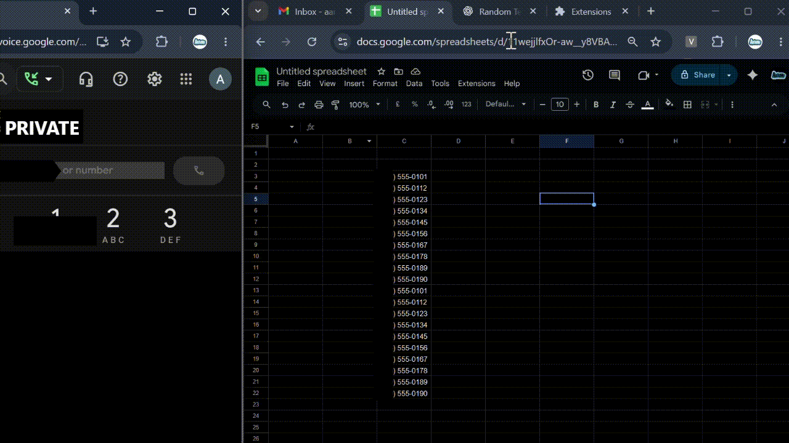
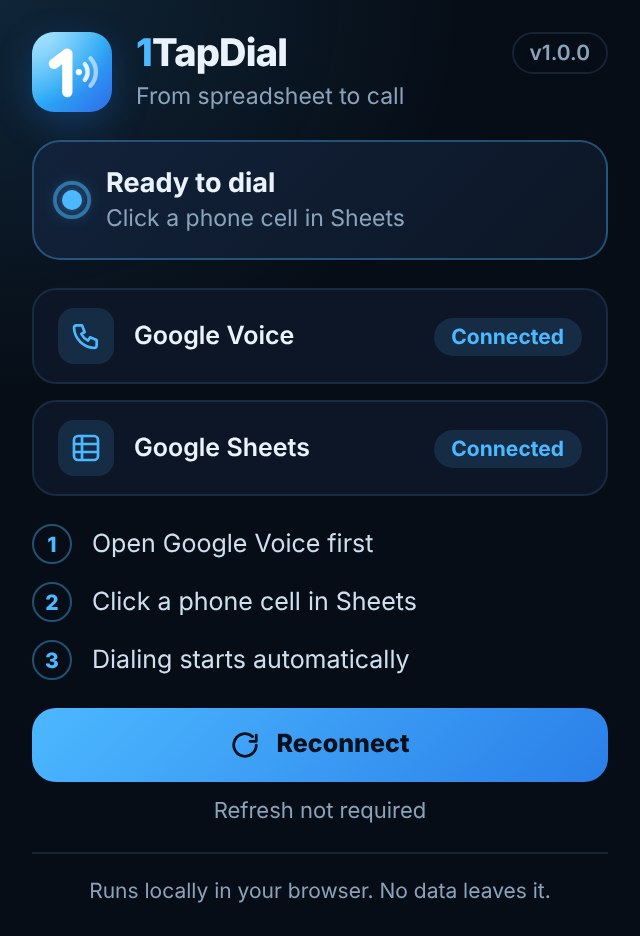

<p align="center">
  
</p>

<h1 align="center">1TapDial</h1>

<p align="center">
  One-click calling from Google Sheets with Google Voice. A lightweight Chrome extension, no backend.
</p>

<p align="center">
  
  
  
  
</p>

---

1TapDial turns a phone number in a spreadsheet into a live call. Click a cell in Google Sheets and the number is sent to
Google Voice, which fills the dialer and starts calling.

Everything runs inside your browser. There is no server, no account and no API key.

<p align="center">
  
</p>

## What you can do

- Dial a number by clicking its cell in Google Sheets
- Use formatted numbers such as `+1 (555) 123-4567` without cleaning them first
- See at a glance whether Google Voice and Google Sheets are connected
- Recover a lost connection with one click, without refreshing any tab
- Keep your data private, since nothing leaves the browser

## Tech stack

| Part        | Technology                                              |
| ----------- | ------------------------------------------------------- |
| Extension   | Chrome Manifest V3, service worker, content scripts     |
| Language    | Vanilla JavaScript, HTML and CSS                        |
| Integration | Google Sheets and Google Voice web interfaces           |
| Build       | None. No dependencies, no bundler                       |

## Requirements

- Google Chrome or another Chromium browser with Manifest V3 support
- A Google account with access to [Google Sheets](https://docs.google.com/spreadsheets/) and [Google Voice](https://voice.google.com/)
- A sheet containing phone numbers of 10 to 15 digits, with an optional leading `+`

## Getting started

```bash
git clone https://github.com/abmdevx/1tapdial.git
cd 1tapdial
```

Then load it into Chrome:

1. Open `chrome://extensions`
2. Turn on **Developer mode** (top right)
3. Click **Load unpacked** and select the `1tapdial` folder
4. Pin **1TapDial** from the extensions menu for quick access

After changing the source, press **Reload** on the extension card in `chrome://extensions`.

## Using it

1. Open [Google Voice](https://voice.google.com/) and sign in
2. Open a Google Sheet that contains phone numbers
3. Click a cell with a number
4. Google Voice fills the dialer and starts the call

<p align="center">
  
</p>

The popup shows whether both tabs are connected. If it stops responding after a navigation or browser update, open it and
press **Reconnect**.

Numbers that are recognised:

```text
5551234567
+15551234567
(555) 123-4567
+1 (555) 123-4567
555-123-4567
```

Only values that resolve to 10 to 15 digits are sent to Google Voice.

## How it fits together

Selecting a cell in Sheets triggers a message to the background service worker, which finds your Google Voice tab and
hands the number to the script running there.

```text
Google Sheets
     │  cell selected / formula bar changes
     ▼
content-sheets.js     extract, normalise, de-duplicate
     │
     ▼
background.js         find the Voice tab, inject if needed
     │
     ▼
content-voice.js      fill the dialer, press Call
     │
     ▼
Google Voice
```

### Project structure

```text
1tapdial/
├── manifest.json        # MV3 config, permissions, entry points
├── background.js        # tab discovery, injection, reconnects
├── content-sheets.js    # reads the selected cell, finds the number
├── content-voice.js     # drives the Google Voice dialer
├── popup.html           # popup markup
├── popup.css            # popup design
├── popup.js             # connection status and Reconnect
└── assets/              # logo, icons, popup preview, demo
```

## Permissions and privacy

| Permission  | Why it is needed                                      |
| ----------- | ----------------------------------------------------- |
| `activeTab` | Work with the tab you are on                          |
| `tabs`      | Find open Sheets and Voice tabs, show connection status |
| `scripting` | Reconnect content scripts after navigation            |
| `alarms`    | Periodically keep supported tabs connected            |

Host access is limited to `https://docs.google.com/*` and `https://voice.google.com/*`.

1TapDial does not upload sheet contents or numbers, store contacts or call history, or use analytics or advertising.
Review the source before loading any unpacked extension, and only use it with data you are allowed to access.

## Troubleshooting

| Problem                    | Fix                                                                 |
| -------------------------- | ------------------------------------------------------------------- |
| Nothing happens on click   | Make sure Google Voice is open and signed in, then press Reconnect |
| Popup says "Not open"      | Open the missing tab, the status updates on its own                 |
| Stopped after a Chrome update | Press Reconnect, or reload the extension                         |
| Number is ignored          | It must contain 10 to 15 digits                                     |

## Known limitations

- Google Voice must be open and signed in in a browser tab
- Google can change the Sheets or Voice interface, which may require selector updates
- Calls depend on your Google Voice account, permissions and region
- There is no automated test suite yet

## Contributing

1. Fork the repo and create a focused branch
2. Load it unpacked and test with both a Sheets tab and a Voice tab open
3. Keep permissions narrow and keep user data inside the browser
4. Open a pull request describing the change, how you tested it and a screenshot for UI changes

Please do not commit real phone numbers or private spreadsheet data.

## License

Released under the [MIT License](./LICENSE).

1TapDial is an independent project and is not affiliated with or endorsed by Google, Google Sheets or Google Voice.
